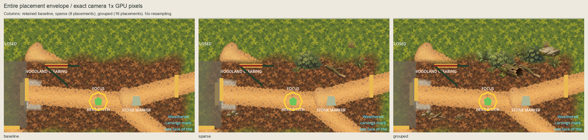

# Woodland Clearing external dressing comparison

Complete series from published `main`
`ff3259c7f6c94dd7c020584ae8ae452873cb40b2`, 2026-10-06 (Australia/Sydney).
The existing [42-module environment artwork approval](../woodland-environment-batch/owner-acceptance.json)
is retained byte-for-byte. No artwork was generated, repainted, resized or installed.

## Complete comparison

Columns are retained baseline, sparse (8 placements) and grouped (16 placements):

- [All wide views: 0.8x / 1x / 2x](review/gpu-series-wide.png)
- [All tall views: 0.8x / 1x / 2x](review/gpu-series-tall.png)
- [Entire native placement envelope](review/complete-details-1x.png)
- [Entire camera-2x placement envelope](review/complete-details-2x.png)
- [Northern belt: native](review/complete-north-belt-1x.png), [camera 2x](review/complete-north-belt-2x.png)
- [Southwestern details: native](review/complete-southwest-details-1x.png), [camera 2x](review/complete-southwest-details-2x.png)



All 24 captures instantiate the unchanged actual scene in a disposable viewport:
18 overview captures at 1280x720 / 1280x827, plus six complete placement views at
800x480 / 1600x960. Only root HUD layers and characters are hidden. After ordinary
startup, controllers are frozen equally for every variant; only explicit camera
scroll and temporary, script-free sprites change. Ground, shells, labels, focus,
testimony, route/channel layers, interactables and concealed state remain visible
or concealed as authored. All 151 recorded owners remain identical throughout.

Overview target center is `(924,380)`; native camera top limits constrain some
actual centers, which are labelled on the boards and recorded per frame. The
dedicated placement cameras cover world `[524,1324) × [0,480)` exactly at native
and 2x scale. These full-envelope and cluster crops contain every placement and
retain exact GPU pixels without resampling. Overview thumbnails are labelled 0.4x.

**Agent recommendation: sparse.** Its eight placements leave more quiet space;
the grouped northern belt shows an alternative with overlapping plants, fallen
wood and a flat stone. Both are retained. This is an agent judgment, with no new
owner arrangement selection, named runtime scope or runtime-view acceptance.

## Placement and clearance

[Placements](placements.json) retain the approved proposed pivots, including their
provisional runtime status. [Inventory](inventory.json) binds native dimensions,
origins, source paint, editable masters, artwork acceptance and the published head.
Sprites use unit scale, zero rotation/offset, `centered=false`, linear filtering,
repeat disabled and z=-60. Nothing is packed, imported or saved into `Main.tscn`.

The authoring mask guards all 96px route capsules with four additional sampled
pixels, retained route/channel alpha with a four-pixel dilation, rounded 60px
opening/specimen guards, and conservative label/interaction/gate/Forester envelopes.
Every entire native artwork rectangle, including a two-pixel filtering margin,
must remain clear. Independent continuous geometry additionally checks the true
route segments, recorded entrance polygons, visible label rectangles and specimen
footprint. The nearest guarded rectangle stays 3.35px beyond the 48px route radius.
The actual artwork rectangle has a further two-pixel margin.

Clearance diagrams are separate from actual-scene captures. Shrubs, fallen wood,
small rocks and details use 16 distinct approved modules across the two arrangements;
trees and large boulders are outside this bounded placement study. All 42 original
exports, five source sheets, 42 editable masters and seven approved review boards
remain unchanged. Production inventory stays 97 assets / 48 masters.

## Static readability comparison

- [Complete native diagnostic series](readability/complete-series-1x.png)
- [Complete camera-2x diagnostic series](readability/complete-series-2x.png)

Thirty images show every arrangement under normal colour, severity-100 protan,
deutan and tritan simulations, plus linear-light luminance. The frozen
[predecessor model and provenance](../clearing-village-edge-ground-feasibility/simulation-model.json)
are bound by SHA-256. Decode sRGB, apply its forward matrix in linear RGB, clip to
display gamut, then encode sRGB; board labels are outside transformed image pixels.
Route and focus labels remain unobscured in these sampled static diagnostics.
They do not establish human accessibility, pacing or broader contrast coverage.

## Reproduce and verify

```sh
python3 art-direction/woodland-clearing-dressing/build.py --check
python3 art-direction/woodland-clearing-dressing/boards.py --check
python3 art-direction/woodland-clearing-dressing/readability.py --check
python3 art-direction/woodland-clearing-dressing/verify.py
```

Checks write nothing. Authoring preflights the entire output set and refuses
existing files; capture preflights all PNGs and refuses existing evidence. Use a
separate revision for future changes. The sandbox renderer exited 134 before any
capture; the identical authorized host command exited 0 with all 24 frame markers
and the explicit pass marker. [Capture status](capture-status.json) records both.

[Verification](verification.json) checks committed Git blobs and SHA-256 for all
8,209 predecessor files outside README/ROADMAP/HANDOVER; artwork acceptance;
native placement/pivot policy; complete camera transforms; unchanged scene owners;
bounded GPU differences; exact crops; deterministic boards/diagnostics; and eight
rejection/numerical probes. The accepted Village Edge checkpoint and inherited
zero-warning/5,033-test product evidence remain byte-exact and verified. No fresh
full product suite or hosted validation is claimed. [Session review](session-review.json)
records the cumulative code and visual review.

Next: record an owner choice or revision for this complete arrangement comparison.
If an arrangement is selected, prepare only its exact named runtime scope; runtime
installation and owner runtime-view confirmation remain separate decisions.
