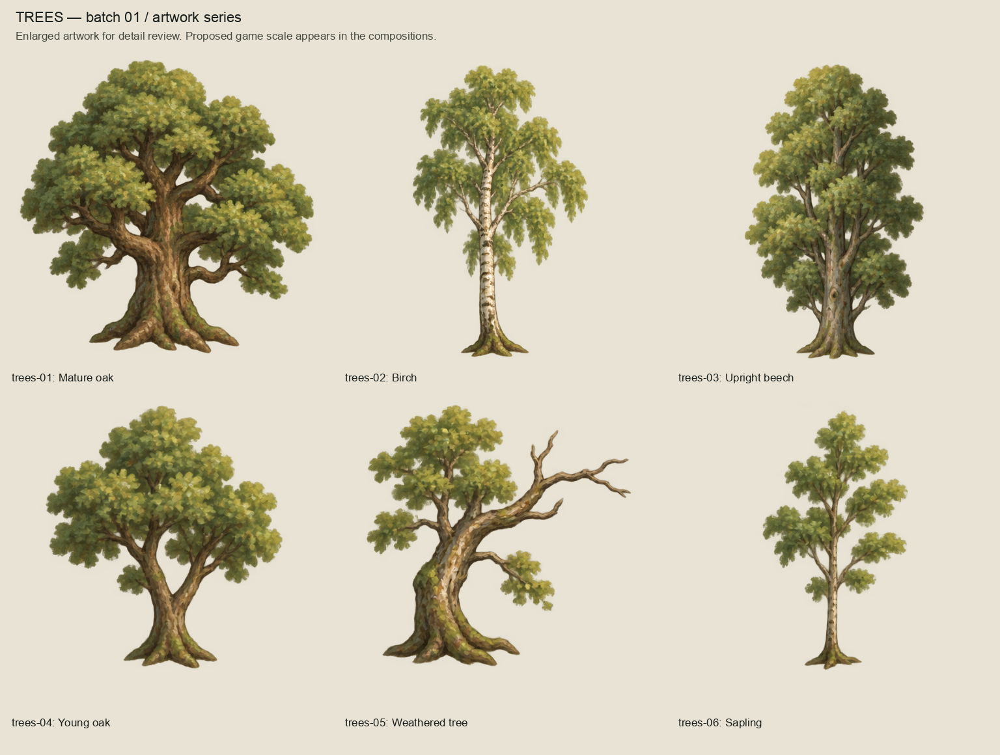
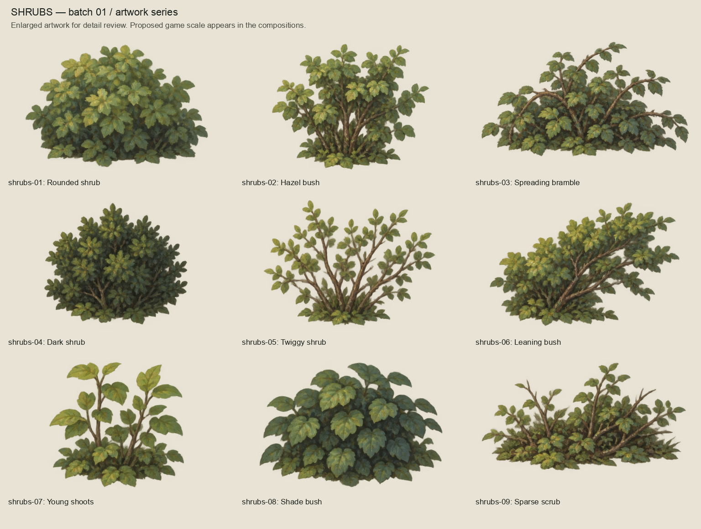
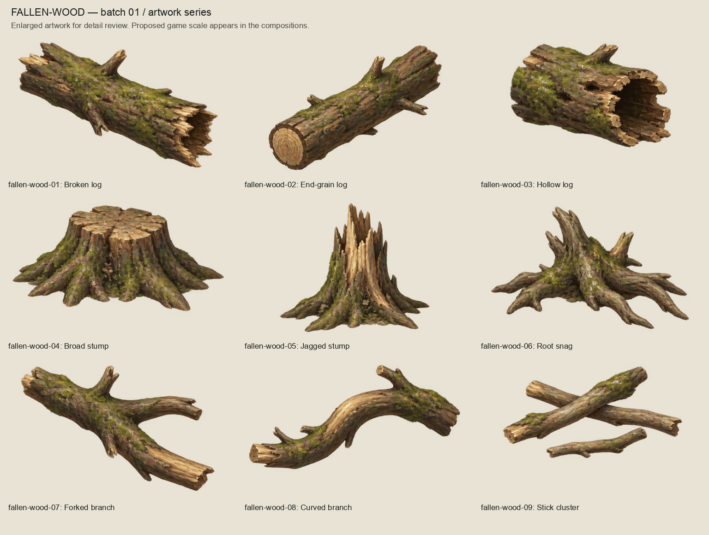
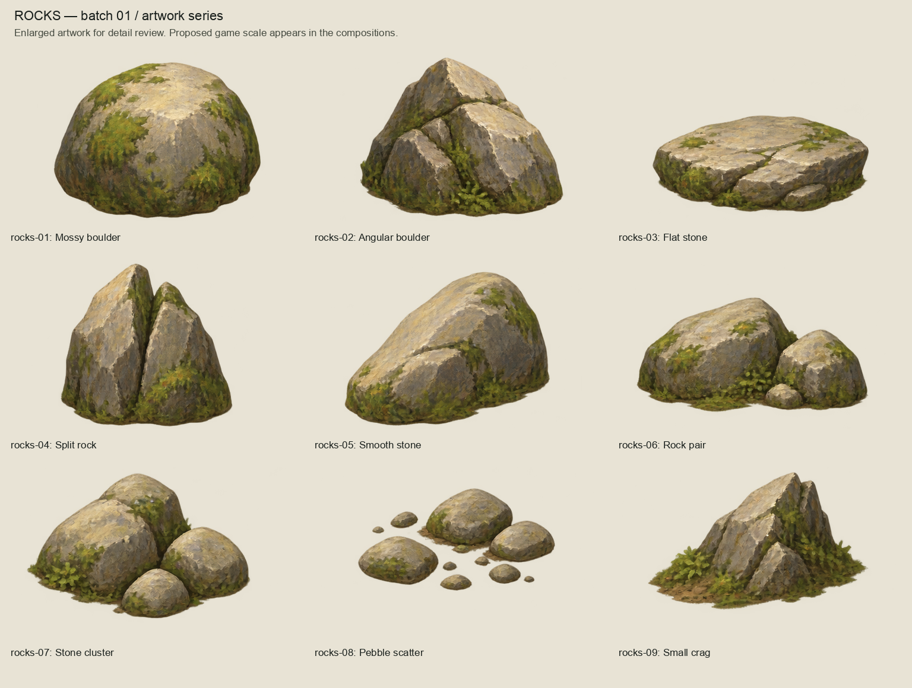
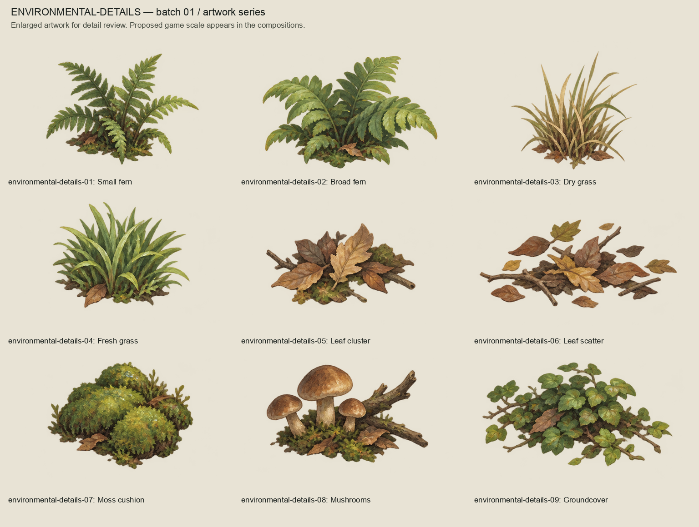
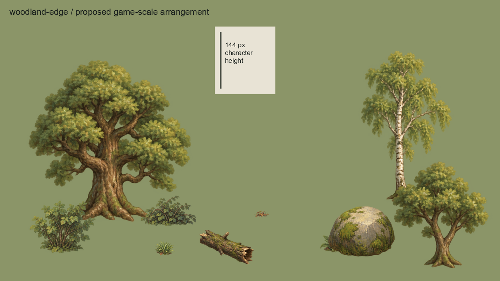
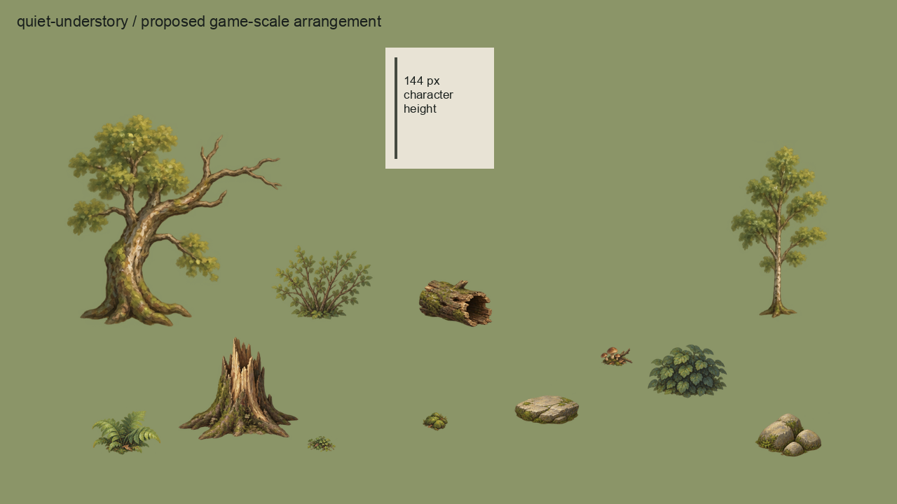

# Woodland environment artwork batch 01

Initial complete category artwork series, produced with the built-in image_gen tool
on 2026-10-04 (Australia/Brisbane). The owner approved the complete presented series:
"This is excellent! Approved". `owner-acceptance.json` binds that approval to the exact
source, master, export and review image hashes. Consolidated validation follows approval.

42 modules: six trees and nine each of shrubs, fallen wood, rocks and small details.
The owner said "The detail is wonderful, very pleasing!" during generation, then approved
the complete series. Preserve that detail level. Final runtime placement and pivots remain
subject to a separate integration review.

## Review series

## Proposed game scale

These are arrangements of the actual exported modules on a plain review background,
at 1280x720 with a 144-pixel character-height ruler. They are external compositions,
not runtime screenshots or opening-region layout proposals.

## Files and reproduction

- `sources/`: five original 1536x1024 generated RGBA family sheets, preserved unchanged.
- `prompts.json`: the exact five prompts used with the built-in tool and transparency enabled.
- `masters/`: 42 editable OpenRaster files at exact 2x export dimensions, each containing
  source paint and a separate blank correction layer. Paint is raster, not reconstructed
  semantic foliage/bark layers; original higher-resolution sheets remain available.
- `exports/`: 42 individual transparent PNG candidates; scale and pivots are provisional.
- `inventory.json`: identities, source crop regions, dimensions, proposed pivots and export hashes.
- `build_review.py`: mechanical module separation, sizing, OpenRaster packaging and review assembly.

Reproduce with `/opt/homebrew/bin/python3 art-direction/woodland-environment-batch/build_review.py`.
Uneven generated spacing requires per-module crop regions. For connected trees, shrubs
and wood, separation retains the largest connected alpha component to exclude neighboring
modules; rock/leaf clusters retain their deliberately disconnected pieces. Original source
RGBA is retained. No alpha repainting, collision or navigation authority is introduced.

Run `/opt/homebrew/bin/python3 art-direction/woodland-environment-batch/validate.py` to check
acceptance hashes, RGBA/alpha integrity, dimensions, proposed pivot bounds and exact 2x
OpenRaster-to-export parity. See `validation.json` for consolidated regression results.
Detailed runtime alpha-edge, placement/pivot, import, collision and accessibility checks
remain part of future named runtime promotion. No production manifest, Godot imports,
scenes or runtime assets were changed.
