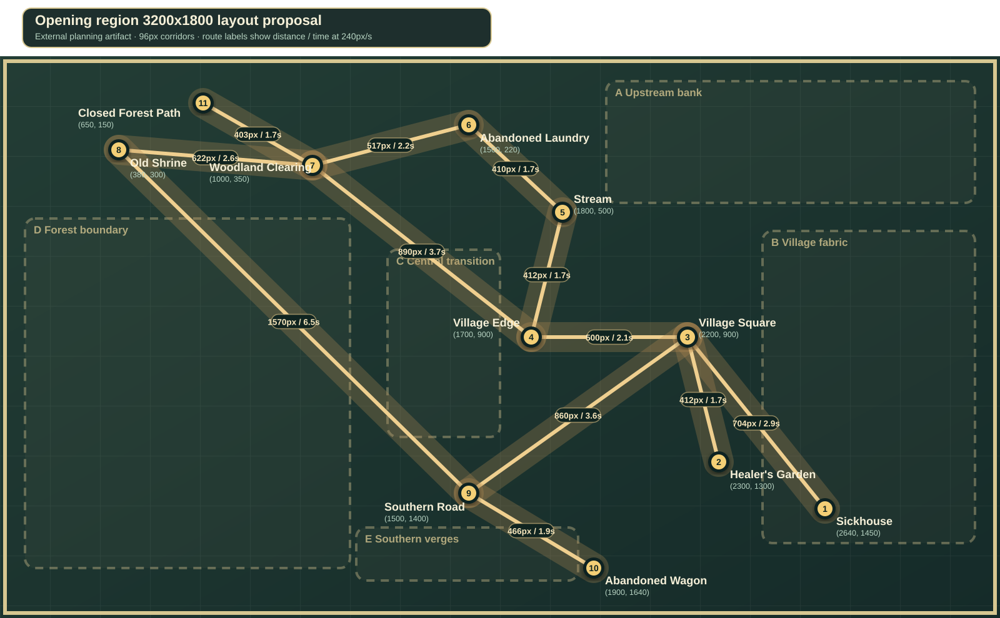
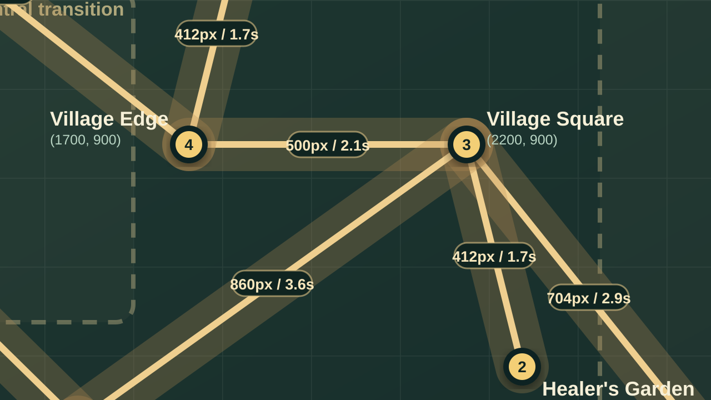
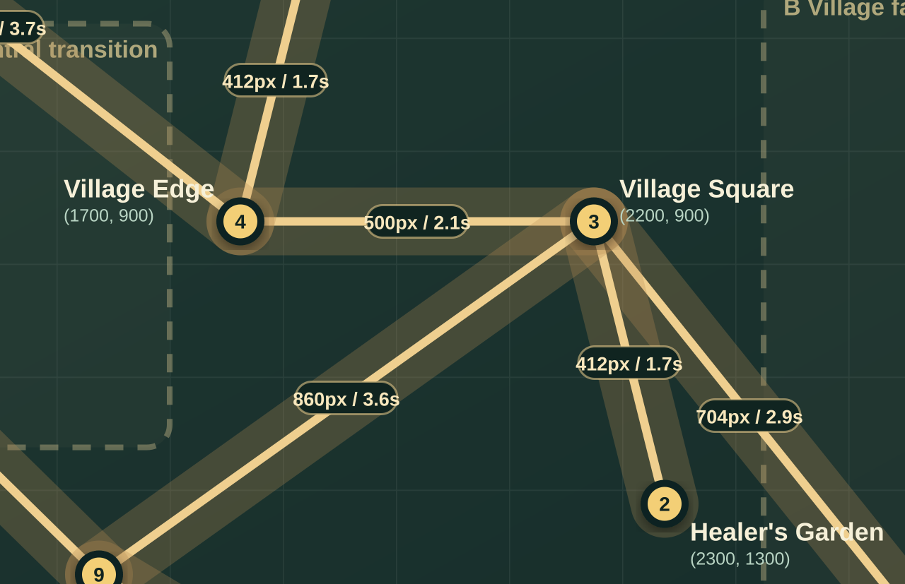

# Opening-region 3200x1800 layout proposal

## Status and boundary

This proposal was explicitly approved on 2026-09-29 and is now the exact source geometry for the
runtime greybox layout. The implementation binds its SHA-256, world bounds, anchors, routes, camera,
collision, and navigation while granting no new discovery, dialogue, clue, or gameplay authority.
The proposal preserves the eleven opening-region
locations, all twelve existing topology edges, the scenario graph, the 240-pixel-per-second Seeker
speed, 96-pixel path width, and 0.8/1.0/2.0 camera zoom tuning.

The proposal uses a 3200x1800 authored world so the accepted 1280x720 base viewport occupies 40%
of the world's width and height at zoom 1.0, rather than 80% of the current 1600x900 world. It does
not scale the accepted character, terrain, path, or prop pixels. The anchor arrangement is a
non-uniform reflow rather than a literal 2x transform: a literal transform made the old-shrine to
southern-road route cross the woodland-clearing to closed-path route without a topology node. The
reflow uses more of the expanded east side and keeps every straight proposal corridor free of
unintended intersections.



`layout-proposal.json` is the single source for the diagrams. `tools/build.py` generates the SVGs;
`tools/validate.py` verifies exact identities, coordinates, topology, endpoint and landmark
clearance, at least 96 pixels between independent route centrelines, camera containment,
content-zone bounds, well-formed SVGs, and byte-deterministic rebuilding. Focused geometry
regressions cover ordinary crossings, collinear overlap, non-intersecting route-band overlap, and
separated parallel routes. The proposal was derived entirely from the repository's current
topology, scene anchors, camera rules, and handover; no external or generated visual source was
used.

## Proposed anchors

Coordinates name planning endpoints, not final interaction bounds or visual centres. All runtime
geometry remains unchanged until a separately approved implementation slice.

| # | Location | Current | Proposed | Planning intent |
| ---: | --- | ---: | ---: | --- |
| 1 | Sickhouse | (920, 820) | (2640, 1450) | Entry and patient destination inside the expanded village side. |
| 2 | Healer's Garden | (880, 620) | (2300, 1300) | Retains the short square branch and stays near the sickhouse. |
| 3 | Village Square | (880, 400) | (2200, 900) | Remains the central four-way investigation junction. |
| 4 | Village Edge | (650, 400) | (1700, 900) | Keeps the village-to-water and village-to-woodland fork. |
| 5 | Stream | (808, 260) | (1800, 500) | Keeps the water route north of the village edge. |
| 6 | Abandoned Laundry | (700, 60) | (1500, 220) | Retains the downstream route and woodland loop. |
| 7 | Woodland Clearing | (470, 70) | (1000, 350) | Remains the woodland hub for shrine, laundry, edge, and closure. |
| 8 | Old Shrine | (160, 70) | (380, 300) | Preserves the western evidence destination and road recovery link. |
| 9 | Southern Road | (620, 620) | (1500, 1400) | Remains the square, shrine, and wagon junction. |
| 10 | Abandoned Wagon | (720, 820) | (1900, 1640) | Retains the short road spur near the southern limit. |
| 11 | Closed Forest Path | (120, 620) | (650, 150) | Moves to the north-west forest boundary to avoid a false crossing. |

The closed path changes compass placement, but not scenario meaning or connectivity. It is still a
terminal boundary reached only from the woodland clearing, with no new deeper-forest location.

## Preserved scenario order

The Sickhouse remains the entry location and connects to the Village Square. The square remains the
first route junction: the Healer's Garden stays a direct branch, the Village Edge continues toward
the stream and woodland loop, and the Southern Road continues toward the wagon. The Stream still
leads to the Abandoned Laundry; both the Village Edge and Laundry still reach the Woodland
Clearing. The clearing still branches to the Old Shrine and the terminal Closed Forest Path. The
shrine still reconnects to the Southern Road recovery route, and the road still ends at the wagon.
No new edge, location, dependency, clue order, or scenario step is proposed.

## Route and travel budget

Distances are straight proposal-centreline estimates. Times are distance divided by the unchanged
240 px/s cardinal movement speed and exclude collision detours, interaction pauses, camera
smoothing, and player hesitation. `X span` is horizontal displacement divided by the 1280-pixel
view width. `Y span` compares vertical displacement with the 720-pixel base view and the 827-pixel
representative fullscreen logical view.

| Existing topology edge | Δx | Δy | Distance | Travel | X span | Y span 720 / 827 |
| --- | ---: | ---: | ---: | ---: | ---: | ---: |
| Village Square–Sickhouse | 440 | 550 | 704 px | 2.9 s | 0.34 | 0.76 / 0.67 |
| Village Square–Healer's Garden | 100 | 400 | 412 px | 1.7 s | 0.08 | 0.56 / 0.48 |
| Village Square–Village Edge | 500 | 0 | 500 px | 2.1 s | 0.39 | 0.00 / 0.00 |
| Village Square–Southern Road | 700 | 500 | 860 px | 3.6 s | 0.55 | 0.69 / 0.60 |
| Village Edge–Stream | 100 | 400 | 412 px | 1.7 s | 0.08 | 0.56 / 0.48 |
| Stream–Abandoned Laundry | 300 | 280 | 410 px | 1.7 s | 0.23 | 0.39 / 0.34 |
| Village Edge–Woodland Clearing | 700 | 550 | 890 px | 3.7 s | 0.55 | 0.76 / 0.67 |
| Abandoned Laundry–Woodland Clearing | 500 | 130 | 517 px | 2.2 s | 0.39 | 0.18 / 0.16 |
| Woodland Clearing–Old Shrine | 620 | 50 | 622 px | 2.6 s | 0.48 | 0.07 / 0.06 |
| Old Shrine–Southern Road | 1120 | 1100 | 1570 px | 6.5 s | 0.88 | 1.53 / 1.33 |
| Southern Road–Abandoned Wagon | 400 | 240 | 466 px | 1.9 s | 0.31 | 0.33 / 0.29 |
| Woodland Clearing–Closed Forest Path | 350 | 200 | 403 px | 1.7 s | 0.27 | 0.28 / 0.24 |

The longest direct connection is the shrine-to-road recovery link at 6.5 seconds. It is the only
edge spanning more than one base-view height. The shortest direct connections take 1.7 seconds.
These are geometry facts, not claims about pacing; a later greybox playtest must decide whether the
accepted layout needs route shaping or dressing without changing the graph.

## Camera and world limits

The proposal retains camera limits `(0, 0)–(3200, 1800)`, zoom tuning 0.8/1.0/2.0, and default
zoom 1.0. The 1280x720 base view needs a covering zoom of 0.4. The taller 1280x827 logical view
needs approximately 0.4595. The retained 0.8 minimum therefore cannot reveal beyond the proposed
world for either representative viewport.

| Viewport | Zoom | Visible world span | Valid camera-centre range |
| --- | ---: | ---: | ---: |
| 1280x720 | 1.0 | 1280x720 | x 640–2560, y 360–1440 |
| 1280x720 | 0.8 | 1600x900 | x 800–2400, y 450–1350 |
| 1280x827 | 1.0 | 1280x827 | x 640–2560, y 413.5–1386.5 |
| 1280x827 | 0.8 | 1600x1033.75 | x 800–2400, y 516.875–1283.125 |

Both review frames use camera centre `(2000, 1000)` at zoom 1.0. The base frame covers
`x=1360–2640, y=640–1360`; the taller frame covers `x=1360–2640, y=586.5–1413.5`. Their shared
centre makes the additional 53.5 logical pixels above and below directly comparable.

### 1280x720 base frame



### 1280x827 representative fullscreen frame



The frames intentionally show only part of adjoining labels and routes at their edges. That is the
expected camera crop, not missing diagram data. The taller frame reveals the Southern Road and
Healer's Garden endpoints more completely without changing scale or horizontal framing.

## Navigation consequences

- The exact twelve-edge topology is unchanged. Straight proposal corridors have no intersection
  unless they share an authored endpoint, so the diagram introduces no accidental route.
- The 96-pixel bands are planning corridors, not final navigation polygons. The implementation
  slice must author navigable clearance, banks, boundaries, openings, collision silhouettes, and
  companion routes together, then verify that every intended edge is reachable and every absent
  edge remains blocked.
- The stream route still needs one explicit traversable crossing aligned with the retained
  Village Edge–Stream–Laundry chain. It must not create a shortcut to another branch.
- The old-shrine to southern-road link is long enough to leave a base view. Camera bounds and
  navigation tests must cover the whole connection rather than sampling only its endpoints.
- The expanded world permits the retained 24-pixel route-endpoint and 120-pixel landmark
  clearances, but final collision geometry must provide materially larger playable clearance for
  the 36-pixel character footprints and 96-pixel path language.

## Empty-area content budget

Dashed regions in the full diagram are explicit future content budgets, not new locations or
authoritative areas.

| Zone | Bounds | Later terrain or content need |
| --- | --- | --- |
| A — Upstream bank | x 1940–3120, y 80–470 | Water continuation, bank transitions, ground variation, and non-interactive foliage. |
| B — Village fabric | x 2440–3120, y 560–1560 | Sickhouse context, building silhouettes, lanes, fences, and ordinary village dressing. |
| C — Central transition | x 1240–1600, y 620–1220 | Ground-language transition and foliage that separate woodland from village without forming a route. |
| D — Forest boundary | x 80–1120, y 520–1640 | Dense boundary dressing and blockers that prevent bypasses around shrine, road, and closed path. |
| E — Southern verges | x 1140–1850, y 1510–1680 | Road shoulders, wagon context, and non-authoritative ground variation near the lower limit. |

Filling these areas would be a later production-art task. This proposal adds no location, clue,
dialogue, interactable, evidence, or scenario step to make empty space appear meaningful.

## Review gate

### Approval and implementation — 2026-09-29

The repository-level technical review recommends accepting this proposal as the candidate for one
coordinated greybox implementation. The retained arrangement has no independent 96-pixel route-band
overlap; the closest independent centrelines remain about 290.6 pixels apart. The north-west closed
path avoids the prior false crossing, the 6.5-second shrine-to-road link is an explicit greybox
hypothesis rather than an asserted pacing success, both representative camera frames stay inside
the world at the retained zoom range, and the five content budgets remain non-authoritative.

The product owner explicitly approved the anchor coordinates, north-west Closed Forest Path,
route-distance budget including the 6.5-second shrine-road hypothesis, camera framing, and five
empty-area budgets. The coordinated runtime implementation retains the proposal's exact SHA-256,
eleven anchors, twelve straight corridors, 96-pixel path language, camera tuning, and closed gate.

Approval and automated validation are not human pacing, route-usability, or accessibility evidence.
A later manual greybox checkpoint must assess those qualities before bulk Direction A art is wired
into ordinary gameplay.

## Rebuild and validate

From the repository root:

```sh
python3 art-direction/world-layout-proposal/tools/build.py
python3 art-direction/world-layout-proposal/tools/validate.py
```
