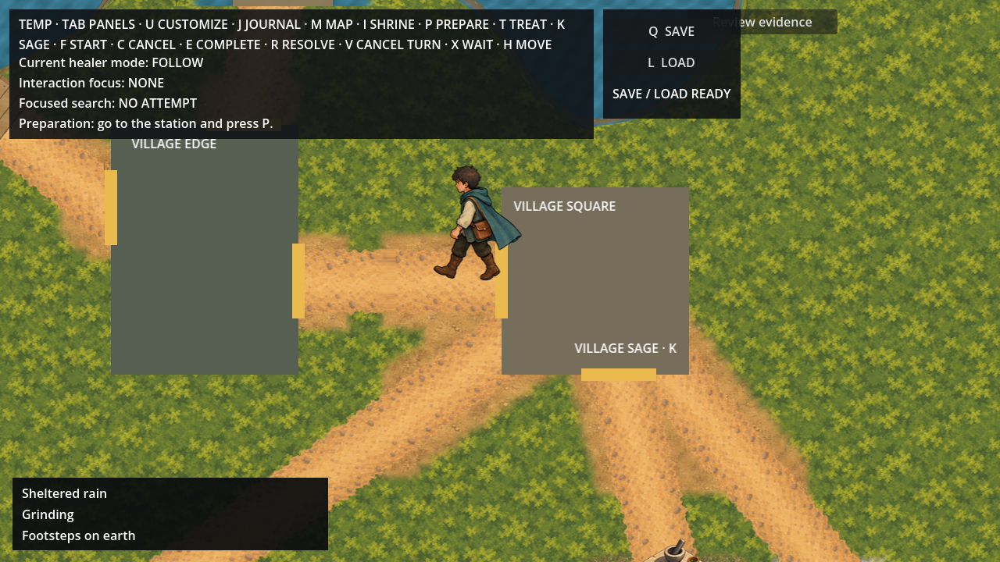
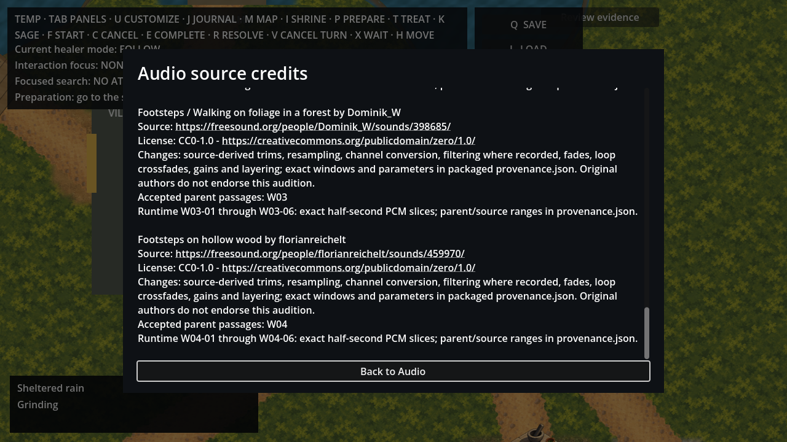

# Approved Seeker terrain footsteps

Completed locally on 2026-10-08 under the owner's exact **approved** statement,
recorded in [authority](../footstep-runtime-authority.json) against the frozen
[proposal](../footstep-runtime-scope.md) and [inventory](../footstep-runtime-scope.json).
The named implementation is complete. This grant does not authorize Git publication.

## Runtime behavior

Ordinary Main now produces Seeker footsteps on supported earth, the declared sickhouse
approach gravel, the two leaf corridors and stream timber rectangle. Sickhouse and
laundry interiors, off-navigation positions and unavailable prerequisites are silent.
This audio registry observes retained geometry; it does not change terrain, navigation,
collision, world knowledge, time or save contracts. Healer/NPC footsteps are outside scope.

The observer runs after the existing `MoveAndSlide`, measuring actual start/end positions.
It rebases on startup/reset, rejects discontinuities, malformed deltas and excessive
displacement, checks support along the segment and interpolates material at the contact.
Contacts occur every 86.4 pixels, with alternating fixed logical legs, deterministic
six-variant cycles per material, a 180 ms minimum interval and at most one output per
tick. Extra crossings are consumed without a replay queue. Logical leg identity does
not attribute the accepted recording to an anatomical foot or synchronize Main's sprite.

Stationary movement, wall pressure, unmapped support, discontinuities, pause, disabled
physics, load/reset and teardown cancel owned cadence, tails and caption. Two Effects
players bound overlap; footsteps acquire no foreground lease. Muting or zeroing
Effects/Master stops tails, continues logical contacts/captions and never replays missed
contacts. Missing playback resources preserve movement and captions. An observer failure
is isolated from movement and other subscribers.

The independent third caption line lasts 750 ms and respects the existing Captions
control. It preserves the region/action lines. Credits include all four original
contributors, source/license URLs, accepted parent edits and exact derivative ranges in
the packaged provenance; the existing six-sound notices remain unchanged.

## Exact assets and native import

There are 24 stereo 48 kHz, PCM24, half-second WAVs: six exact sample ranges from each
accepted W01–W04 parent. Each contains 24,000 frames and 144,000 PCM bytes. Extraction
copies samples without trimming within the declared range, gain, resampling, fades,
normalization or loop processing. The successor validator independently compares every
sample against the accepted parent. All 82 accepted-audition bindings and protected
gait/art/physical inputs still match.

Godot 4.6.3 imports these as uncompressed stereo PCM16 at 48 kHz, 96,000 data bytes,
with looping disabled. [Native inspection](decoded-streams.json) verifies all 24 streams:
decoded values equal the original signed PCM24 values shifted right eight bits, with
zero LSB discrepancy. WAV preservation and native playback precision are separate facts.

## Verification

| Check | Result |
| --- | --- |
| Restore, full solution build, format, workflows, scenario validator | Pass; build has zero warnings/errors |
| Domain / Application / Infrastructure / Architecture unit tests | 2,839 / 976 / 1,272 / 8; **5,095** total |
| New material/cadence tests | 23, including invalid motion, boundaries, leg/variant order, wrapping and reset |
| Retained Godot suite | Pass; **293** engine launches recorded |
| Ordinary Main | Four modes pass: normal, muted, missing resources, captions off |
| Actual physics | Earth/leaves/gravel/timber contacts, stationary/wall rejection, subscriber isolation, pause/disable/load/teardown |
| Save parity | All four full save roots are byte-identical, including journal/map/routes |
| Master output | **67** finite cases pass using the installed controller and mixer |
| Boundary validator | Exact grant/PCM, additive Main/export, retained movement and four rejection probes pass |
| Resource export | 24 contacts, six retained streams and eight notices verified against actual exported bytes |
| Views | Captions/credits checked at 1280×720 and 1600×900; credits scroll and return focus pass |

Save-root SHA256:
`ce47a7c8968f6b404d8fc7cd40f8416962fda00a983e7ff3f5d1cf61ad896d2a`.
The fixture and actual movement observations are retained in [actions](actions/normal.json)
and [movement results](actions/normal.json.movement.json). The expected isolated
`InvalidOperationException` print proves the deliberately failing subscriber did not
stop the next subscriber or movement. It is not an unresolved runtime failure.

The 67 rendered cases cover all 24 variants, full/half/zero Effects gain, Effects and
Master mute/zero, mono, Reduced range, Ambience isolation, overlap/rate/material changes,
stop, mute/unmute without replay, concurrent regional/action audio and missing playback.
The silence analysis allows the first 100 ms of bus settling, then requires silence.
The losslessly compressed actual Master capture is [master.wav.gz](output/master.wav.gz),
with [timeline](output/timeline.json), [measurements](output/measurements.json) and
[render input hashes](output/render-inputs.json). Its decompressed SHA256 is
`c32b38253f730504bf703b89f8d635936a8d4dc8009da5117e64f703de3514e3`.

The disposable render checkout uses identical controller/mixer/sample inputs and a
320×180 proof window; it does not rewrite `game/project.godot`. Later Main diagnostic
and credits/provenance-only changes leave the captured playback sources unchanged,
which was verified against the snapshot. Actual movement/cadence is checked separately
in ordinary Main and pure tests; the output proof calls the installed presentation entry.

The diagnostic sequence measures **−35.31 LUFS**, **−12.70 dBTP**, **16.50 LU LRA**.
Its silence tests, gaps and mixed presets are not a representative gameplay loudness
passage: the integrated value is below the provisional −25 to −21 LUFS audition range,
and LRA exceeds the Default 8–12 LU target. True peak is below the −1 dBTP delivery
ceiling. No normalization was applied; the analyzer's `output_*` values describe only
ffmpeg's hypothetical normalization. First-signal offsets for variant 01 are roughly
6.54/4.25/11.77/18.77 ms for earth/gravel/leaves/timber after the retained window starts.
They include recorded leading samples and do not prove device latency or anatomical sync.

The [export inventory](export-inventory.json) records the actual resource ZIP hash.
[audio-resource-subset.zip](audio-resource-subset.zip) retains 68 unchanged entries from
that ZIP: stream import maps, native caches and notices. Full macOS executable export
remains unavailable due to the missing mono template and existing `game/Allrpcs.Game.sln`
export lookup mismatch. Resource packaging is verified; no runnable release or new
device-listening claim is made.

## Reproduction and views

Run from the repository root:

```sh
python3 scripts/validate-footstep-audio-runtime.py --reviewed
python3 scripts/check-continuation.py --self-test
dotnet build Allrpcs.sln --no-restore -m:1 /nr:false
dotnet format Allrpcs.sln --no-restore --verify-no-changes
./scripts/smoke-godot.sh
ALLRPCS_FOOTSTEP_MAIN_CHECK=1 ALLRPCS_FOOTSTEP_MODE=normal godot --headless --path game res://Main.tscn
godot --headless --path game --script /Users/hherb/src/allrpcs/audio-direction/footstep-runtime-review/checks/inspect-footstep-streams.gd
```

The full restore/test/workflow/scenario/import/export commands and outputs are retained
in [checks](checks/build.log). Graphical Godot and sandbox log/settings restrictions
were handled by identical authorized host retries. The standalone
`res://FootstepAudioRuntimeProof.tscn` starts stopped and provides explicit diagnostic
playback. Movie Maker reproduction requires `ALLRPCS_FOOTSTEP_OUTPUT_CHECK=1`, an
absolute `ALLRPCS_FOOTSTEP_TIMELINE`, `--write-movie`, `--fixed-fps 60`, and the same
runtime/resources. Bundled NumPy Python can analyze the decompressed capture with
`scripts/check-footstep-audio-output.py --wave ... --timeline ... --output ...`.




Additional retained views cover [1600 captions](views/captions-1600.png),
[1600 credits](views/credits-footsteps-1600.png) and all four material contacts.
The recorded editor rewrite remains byte-identical with SHA256
`36bfb7c7a54399cc8d27c02b73c7990766d7db44e7452655cb6a496866653fca`.
No commit/push, new audition, changed accepted art or gait, broader action audio,
positional cue, music or release is claimed.
