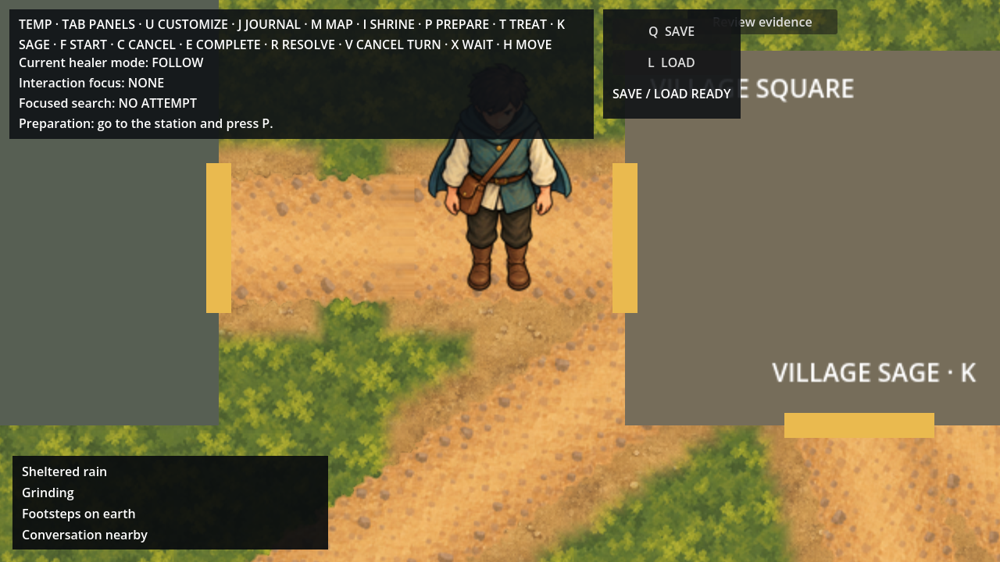
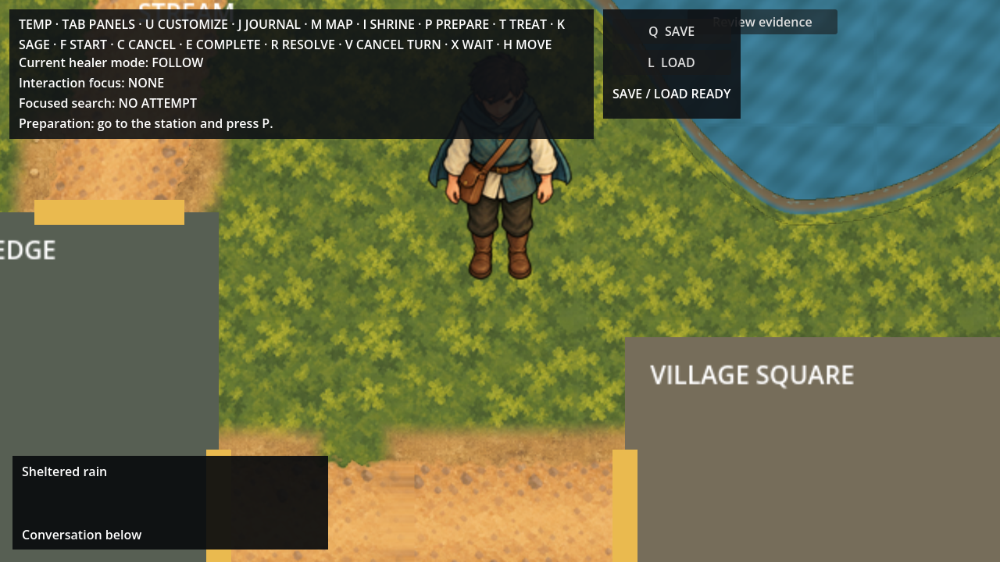
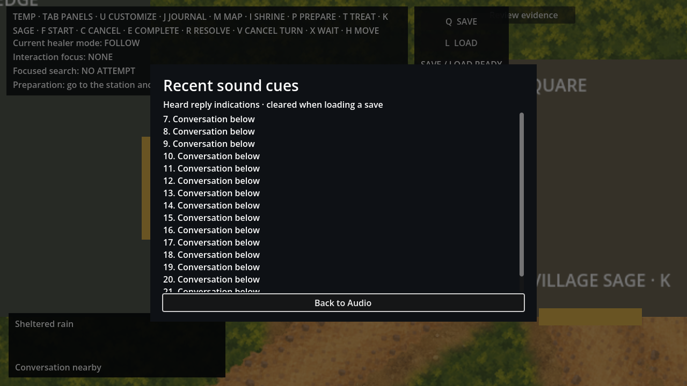

# Approved positional waterway and heard reply cues

The owner's **approved** statement on 2026-10-08 grants the exact frozen
[proposal](../positional-cue-runtime-scope.md), [inventory](../positional-cue-runtime-scope.json)
and one PCM extraction. [Authority](../positional-cue-runtime-authority.json) records
that grant and the standing task commit/push instruction. This named implementation is
complete; the broader positional-audio roadmap item remains unfinished.

## Runtime behavior

B02 has one positional owner on Ambience. The existing material controller retains
regional selection and its ramp, forwarding only B02's weight. Its source is the nearest
point on the retained rectangular water extent, transformed through the projection to
world space. A top-level Seeker AudioListener2D owns attenuation independently of camera
zoom. The water player has 768-pixel linear falloff, panning strength 0.6, pitch 1 and
one voice. The accepted B02 water/rain composite remains unchanged: rain spatializes
with water, and native positional centre scaling is retained without compensation.

The ordinary response recorder emits an internal notification only after the exact
occurrence, transcript append and one-time delivery guard commit. Only registered
Healer/Sage sources, the current complete speaking response, the exact recorded delivery
and a captured audience admitting the Seeker qualify. Existing ordinary/whisper hearing
remains 192/48 pixels, inclusively. Live distance can remove admission; camera position
only changes caption bearing and stereo pan. Unheard responses disclose no cue.

One optional Dialogue player produces a half-second click with the corresponding
192/48-pixel linear falloff. It acquires no foreground lease and starts at most once per
second, without a replay queue. Captions/history remain available when the sound is
muted, missing or rate limited. The generic fourth caption line lasts three seconds and
uses “Conversation nearby” or one of eight screen bearings, without names or content.
The other three caption lines remain independent. Audio → Recent sound cues exposes up
to 16 transient numbered entries with selectable, scrollable text and keyboard return
focus. Successful load and teardown clear history; failed load preserves it.

Departure, cancellation, invalid ownership, a teleport over 96 pixels in one physics
sample, reset and teardown stop the reply. Return and unmute never replay it. A missing
explicit listener suppresses positional presentation; a missing named bus suppresses
playback rather than routing it through Master. Presentation subscriber failures cannot
undo or duplicate the committed response. Existing action leases, other beds, footsteps,
world roots, save formats, accepted artwork and gait are preserved.

## Exact asset and packaging

`A06-D01.wav` copies accepted A06-Dialogue frames [192000,216000), exactly 4–4.5 seconds:
24,000 stereo PCM24 frames at 48 kHz, 144,000 sample bytes, with no processing or new
selection. The extraction and independent validator compare exact PCM. Godot imports it
as uncompressed PCM16; [decoder parity](decoded-parity.json) proves each native sample
equals the original PCM24 sample shifted right eight bits. Shipping WAV precision and
native playback precision are distinct.

The packaged credit/provenance and CC0 notice retain Kenney's source and licence links.
[Actual resource export](export-inventory.json) verifies 24 footstep streams, six prior
material streams, this one new stream and eleven notices against native cache/import and
source bytes. [Audio subset](audio-resource-subset.zip) retains all 73 exported entries.
It verifies resources, not a runnable application release.

## Verification

| Check | Result |
| --- | --- |
| Restore, solution/game builds, format, workflow and scenario validation | Pass; builds have zero warnings/errors; five scenario evidence definitions |
| Domain / Application / Infrastructure / Architecture tests | 2,839 / 998 / 1,272 / 8; **5,117** total, including 22 new spatial/history cases |
| Retained Godot suite | Pass; **293** launches, no error lines |
| Main modes | Normal, muted, missing streams, captions off; exact transcripts and byte-identical full save roots |
| Geometry and hearing | Eleven water anchors, transformed extent, explicit listener, actual camera zoom 0.8/1/2 at both viewports, inclusive 192/48 gates |
| Reply isolation | Repeated frames, foreign/stale/chunk/source/range/audience rejection, missing bus/listener, subscriber failure, departure/cancel/teleport/return |
| UI/reset | Bounded history, four lines, credits, viewport fit and return focus; successful/failed full restore |
| Actual Master output | **44** measured cases pass |
| Successor boundary | Exact authority/PCM/import, protected inputs, additive Main/export, single B02 owner and four forbidden-mutation rejection probes |
| Retained action behavior | Material Main smoke passes; standalone footstep diagnostic starts stopped |
| Packaging | 31 streams, 11 notices, native derivative parity and lossless captured audio parity pass |

The controlled Main fixture sends deterministic complete responses through the ordinary
recorder, without provider calls. Its temporary transform/position arrangements are
verification fixtures, not shipping geography changes. Four full serialized saves and
[parity](main-parity.json) retain the comparison. The expected “isolated presentation
probe” print verifies exception isolation; retained shutdown ObjectDB warnings do not
claim leak-free execution.

The output proof uses installed controllers/mixer and explicit diagnostic positions.
Its 44 cases cover category/Master gains and mute, mono, Reduced range, missing streams,
other-bus isolation, distance boundaries and halves, left/right/above, zoom independence,
whisper falloff, stop, mute/unmute, a 34-second water loop, crossfade/retarget, and a mix
with A04/A05, one retained footstep and the reply. [Measurements](output/measurements.json)
contain RMS, peak, first-signal timeline offsets and ffmpeg input LUFS/true peak/LRA.
Offsets include the half-second scheduled start and recorded leading samples, not device
latency. The analyzer's `output_*` loudness fields describe hypothetical normalization;
no normalization is applied. This diagnostic sequence includes control silences and
preset changes and does not establish ordinary-play loudness compliance.

[Master FLAC](output/master.flac) preserves the actual native PCM16 stereo 48 kHz Movie
Maker capture losslessly; [capture metadata](output/capture.json) verifies exact decoded
sample parity. There is no 32-bit capture claim. [Render bindings](output/render-inputs.json)
bind the playback inputs, which stayed unchanged through later Main-check additions.
The 241 MB AVI remains temporary; its video is not needed to reproduce the audio results.

The historical full-quality script and predecessor validators contain frozen allowlists
that predate this successor. They were preserved. Equivalent restore/format/build/four
unit-project/scenario/retained-Godot commands were run, with the new bounded validator;
unchanged accepted art evidence was reused. Product evidence is not rerun for later
prose and queue maintenance.

## Reproduction and views

Run from the repository root; graphical/engine log access may require host execution.

```sh
python3 scripts/validate-positional-audio-runtime.py --reviewed
python3 scripts/check-continuation.py --self-test
dotnet format Allrpcs.sln --no-restore --verify-no-changes
dotnet build game/Allrpcs.Game.csproj --no-restore -m:1 /nr:false
./scripts/smoke-godot.sh
ALLRPCS_POSITIONAL_MAIN_CHECK=1 ALLRPCS_POSITIONAL_MODE=normal godot --headless --path game res://Main.tscn
ALLRPCS_POSITIONAL_OUTPUT_CHECK=1 ALLRPCS_POSITIONAL_TIMELINE=/tmp/positional-timeline.json godot --path game res://PositionalAudioRuntimeProof.tscn --write-movie /tmp/positional-master.avi --fixed-fps 60
ffmpeg -i output/master.flac -c:a pcm_s16le /tmp/positional-master.wav
```

For the archived FLAC, resolve `output/master.flac` relative to this review directory.
Use bundled NumPy Python with `scripts/check-positional-audio-output.py --wave ...
--timeline ... --output ...`. Actual exports can be inspected with
`checks/verify-export.py /tmp/allrpcs-positional-resources.zip`. The proof starts stopped
unless its explicit output-check environment variable is set. Check logs retain all
command outcomes, with trailing whitespace normalized; [verification](../positional-cue-runtime-verification.json) binds the
reviewed shipping inputs and evidence.

Views at 1280×720 and 1600×900 show the actual ordinary Main canvas under the deterministic
fixture. Reply captions/history come through the recorder. “Grinding” and “Footsteps on
earth” are explicitly filled caption-layout fixtures, not evidence of concurrent actions.
The credits viewport and return control are visible; the new Kenney text is additionally
asserted in the scrollable full credit body.





Additional views retain 1600 captions/off-screen/history and both credits panels.
Full macOS executable export remains unavailable due to the missing mono template and
inherited `game/Allrpcs.Game.sln` lookup mismatch. No new device listening, speech,
microphone, broader positional integration, music or release is claimed. The unrelated
`game/project.godot` editor rewrite remains byte-identical and excluded from publication.
